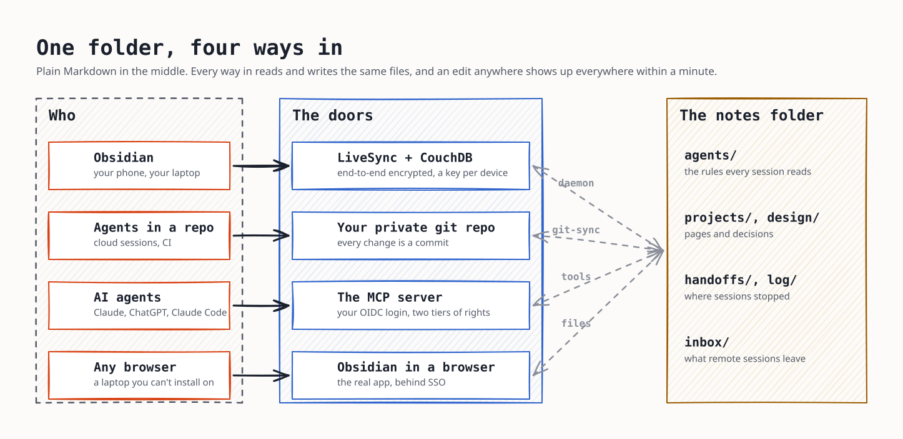

# agent-notes

> **A point-in-time snapshot (November 2026), not a maintained product.** This is the design I run in
> my own lab, packaged so you can see it work end to end and take the ideas, or hand it to your own AI
> agent to build something similar on your resources ([AGENTS.md](AGENTS.md) is written for that). No
> promise of updates, fixes or support; the pins are as of the snapshot. Read before you run.

Shared notes for every AI session you run: Claude Code on the laptop, Claude on
the phone, cloud sessions, ChatGPT. One folder of Markdown that syncs to
Obsidian on your devices, to a private git repo, and to an MCP server, so a
session anywhere reads what the last one decided.

The notes end up in every future session, so they're the thing to protect. By
default a remote agent can read, and leave notes in an inbox. Anything more
takes your approval, with a fresh second-factor login, for that one session. A
prompt-injected session can ask, but it can't approve.



More figures in [docs/diagrams](docs/diagrams) (`render.sh` redraws them from `figures.py`).

## The core and the lab

| | What it is | Where |
|---|---|---|
| **The core** | what you'd deploy: the MCP server, the sync stack (CouchDB, the LiveSync daemon, git-sync, the gate), Obsidian in a browser, the Docker Compose file and the Terraform module, the device tools, the hooks, the inbox reviewer | `server/`, `sync/`, `deploy/`, `scripts/`, `hooks/`, `reviewer/`, `vault-template/` |
| **The lab** | what the end-to-end tests put around it so it runs anywhere with no account: a mock OIDC provider, an SSH git host, an internal CA, a stand-in phone and MCP client, a kind cluster. Replace each with yours | `lab/` ([lab/README.md](lab/README.md)) |

See it work first, on your machine, in about three minutes:

```bash
KEEP=1 lab/compose/e2e.sh     # the whole stack with lab stand-ins; 40-odd checks; leaves it running
```

## What you get

- **An MCP server** with list, read, search, write, append, move,
  `request_elevation`, the inbox review tools, and delete for trusted sessions
  only (git keeps the history). Any OpenID Connect provider for the
  login.
- **Two tiers.** Remote clients (claude.ai, ChatGPT, cloud sessions) are
  restricted to the inbox; your enrolled machines (a device token) and sessions
  you approved are trusted. The policy lives in your deployment, never in the notes.
- **An inbox review**: promotes what restricted sessions left (handoffs, logs,
  decisions) along fixed routes. A trusted session reviews when you ask, with
  its own model ("review my inbox"), and an optional hourly job does the rest;
  either way a model judges what an item says, and code decides who may move
  it and where. Sessions tell you when items are waiting.
- **Obsidian sync** through Self-hosted LiveSync, end-to-end encrypted, one key
  per device, Setup URIs built from the same defaults as the server.
- **git** as history and backup, and the way in for cloud agents.
- **Obsidian in a browser** for machines where you can't install it
  (optional).
- **Session hooks** for Claude Code: the rules at the start of every session, a
  log entry and a handoff at the end (`hooks/`).
- **Two deployments**: Docker Compose on one machine, or a Terraform module for
  Kubernetes. Both hardened the same way: non-root, read-only filesystems, no
  capabilities, nothing listening but the TLS edge.

**Setting it up with an AI agent?** Point it at [AGENTS.md](AGENTS.md): the
procedure written for an LLM, with what to ask you, what to check, and what it
must never do.

## Quick start (Docker Compose)

You need a machine with Docker, three DNS names pointing at it, an OIDC
provider, and a private git repository for the notes.

```bash
git clone https://github.com/sam-dumont/agent-notes && cd agent-notes
cp deploy/compose/.env.example deploy/compose/.env
scripts/init-env.sh deploy/compose/.env       # random secrets, nothing printed
$EDITOR deploy/compose/.env                    # hostnames, OIDC client, your sub, git remote
mkdir -p secrets/git && $EDITOR secrets/git/token && chmod 600 secrets/git/token
scripts/device-key.sh phone                    # one per Obsidian device
cd deploy/compose && docker compose up -d     # builds the server image from this checkout
```

Then:

1. **Seed the notes**: push `vault-template/` (or your existing Obsidian vault)
   to your git repository. git-sync picks it up within 30 seconds.
2. **Connect Obsidian**: build the phone's Setup URI (docs/devices.md) and open
   it in the Self-hosted LiveSync plugin. Fetch from the server.
3. **Connect your agents**: add `https://<MCP_HOST>/mcp` as a custom connector
   in claude.ai or ChatGPT, or `claude mcp add --transport http notes
   https://<MCP_HOST>/mcp` in Claude Code. Each one logs in once.
4. **Optional**: the session hooks (hooks/README.md), Obsidian in a browser
   (`COMPOSE_PROFILES=edge,web`, docs/obsidian-web.md).

Kubernetes: deploy/terraform/README.md.

## Docs

| | |
|---|---|
| [Architecture](docs/architecture.md) | the pieces and why each is there |
| [Security model](docs/security.md) | tiers, elevation, the gate, secrets, known limits |
| [The inbox and its review](docs/inbox.md) | where restricted sessions write, and how it gets promoted |
| [OIDC provider](docs/oidc.md) | the client to create, proving a second factor, Auth0's passkey quirk |
| [Devices](docs/devices.md) | Obsidian devices (keys, Setup URIs, revoking) and enrolled machines |
| [The git remote](docs/git.md) | tokens, GitHub App, SSH, what git-sync refuses |
| [Operations](docs/operations.md) | what to alert on, backups, upgrades, rotation |
| [Obsidian in a browser](docs/obsidian-web.md) | Ignis, and what it can reach |

## Tests

```bash
cd server && uv run pytest -q          # the server, offline
lab/compose/e2e.sh                     # the whole stack (Docker Compose), ~3 minutes
E2E_WEB=1 lab/compose/e2e.sh           # plus Obsidian in a browser
lab/kind/run.sh                        # the Terraform module on a throwaway kind cluster
```

CI runs all of them on every push. What each run proves, and what it can't: [lab/README.md](lab/README.md).

## License

MIT. Obsidian, Self-hosted LiveSync and Ignis are separate projects with their
own licenses; this repository runs their published images and never ships
Obsidian's app.
